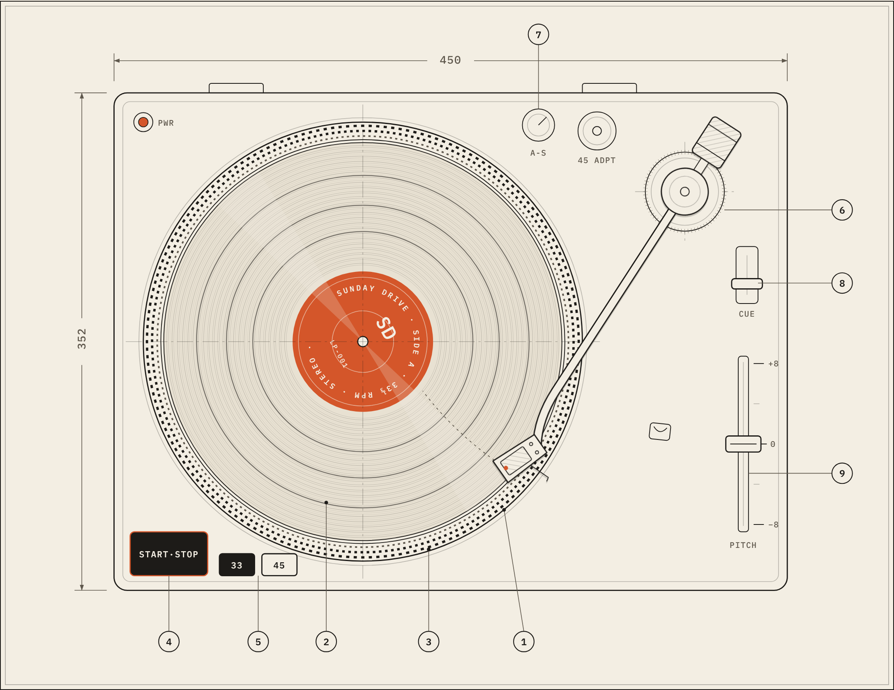

# Turntable player

A top-down technical drawing of a turntable that plays a Spotify playlist.
It is plain HTML, CSS and JS with no build step.



## Run it

Open `index.html` in a browser, or serve the folder:

```sh
cd turntable-player && python3 -m http.server 8000
# → http://localhost:8000/?playlist=https://open.spotify.com/playlist/<id>
```

## Set your playlist

You can set it in any of three ways. The first one found wins.

1. Add `?playlist=<link | spotify:playlist:… | id>` to the page URL.
2. Paste a link into the **Playlist link** form. The page remembers it in this browser.
3. Set `CONFIG.playlist` at the top of `turntable.js`. Use this for the site default.

## How it works

- The page uses the official [Spotify iFrame API](https://developer.spotify.com/documentation/embeds/references/iframe-api).
  It needs no API keys and no app registration.
- **Start·Stop**, clicking the record, clicking the tonearm, or pressing the space bar calls `togglePlay()` on the embed.
- The platter speeds up and coasts down like a real one. Speed (33⅓ / 45) and pitch (±8%) only change how fast the drawing spins. They don't change the audio.
- The tonearm sweeps from the outer groove to the inner groove as the current song plays. The orange arc marks how far it has gone. When paused, the arm lifts in place (larger shadow, cue lever up). When stopped, it goes back to the rest.
- With no playlist loaded, the deck runs in demo mode with no audio.

### Spotify limitations

- Listeners who are signed in to Spotify in that browser hear full tracks. Everyone else hears 30-second previews.
- Some browsers, mainly Safari and iOS, only allow audio after a click inside the Spotify frame. If the first press does nothing, the page shows a hint to press play in the embed once.
- The embed has no API for skipping tracks, so skip and track info stay in the Spotify player under the drawing.

## Restyling

All colours and fonts are CSS variables at the top of `turntable.css` (`--paper`, `--ink`, `--accent`, `--mono`, `--sans`, …).
There is a light and a dark set. Change those values to match sundaydrv.com.

## Drawing geometry

The SVG in `index.html` uses drawing units (≈ 2 units per mm):

| Part | Value |
| --- | --- |
| Plinth | 920 × 680, origin (40, 40) |
| Platter centre | (380, 380), r = 300 |
| Tonearm pivot | (820, 175), effective length 450 |

If you move the platter or the pivot, update the matching constants at the top of `turntable.js`.
